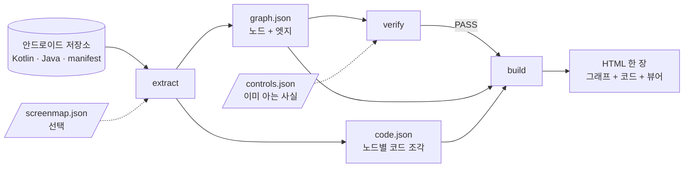
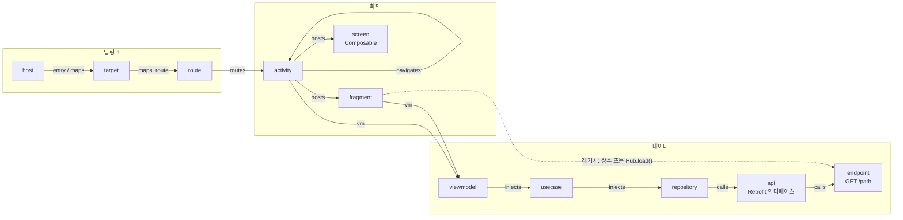
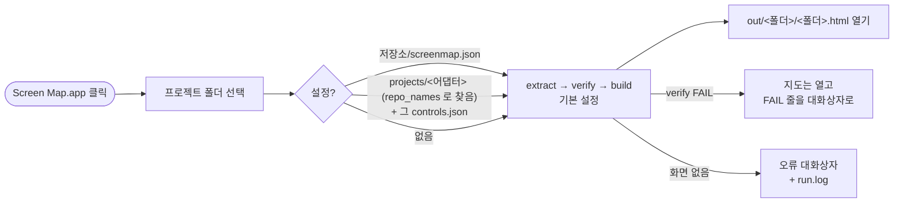

# android-screen-map

> English README: [README.en.md](README.en.md)

안드로이드(Kotlin) 저장소를 가리키면 **HTML 한 장**이 나옵니다. 모든 화면, 딥링크가 어느 화면에 닿는지, 각 화면이 결국 어떤 REST
엔드포인트를 부르는지를 확대·축소되는 그래프로 보여 주고, 노드를 누르면 원문 코드가 바로 나옵니다.

빌드도 컴파일러도 의존성도 없습니다. Python 3.9 이상만 있으면 되고, 정규식과 괄호 짝 맞추기로 소스를 읽습니다.
보통 크기의 앱(Kotlin 파일 1,400개)이 5초 정도 걸립니다.

## 무엇을 읽는가

| 층 | 근거가 되는 코드 | 노드 / 엣지 |
|---|---|---|
| 화면 | `AndroidManifest.xml` 의 activity, `*Fragment` 클래스(Kotlin·Java), `@Composable fun *Screen(` | `activity` · `fragment` · `screen` |
| 딥링크 | 매니페스트 intent-filter 의 host → (선택) 라우팅 코드: host 상수 → target → route → navigator → launcher → helper | `host` → `target` → `route` → activity (`entry`, `maps`, `maps_route`, `routes`) |
| 화면 이동 | `Intent(ctx, X::class)`, `startActivity<X>()`, `X.createIntent(`, 헬퍼 오브젝트 호출(오버로드는 호출 인자로 구분) | `navigates` |
| 데이터 | ViewModel → UseCase → Repository 인터페이스 → 구현 → [DataSource → 구현] → Retrofit 인터페이스 → `@GET/@POST`. 레거시 앱은 화면이 직접 참조하거나 헬퍼 메서드 한 단계를 거쳐 닿는 엔드포인트 상수(`Hub.load(`, `Hub.getInstance().load(` — `endpoints` 설정) | `vm` · `injects` · `calls` · 노드별 `endpoints` |
| 코드 | 모든 노드의 선언부(주석 포함)를 실제 줄 번호와 함께 | 상세 패널에 표시 |

모든 엣지에 신뢰도가 붙습니다. **parsed**(코드에서 읽음), **heuristic**(패키지 근접 추정, 점선), **dynamic**(실행 시 파라미터로
정해짐, 점점선이며 기본은 숨김).

## 동작 원리

세 단계이고 각각 CLI 명령입니다(`all` 이 순서대로 돌립니다). 대상 저장소에는 아무것도 쓰지 않습니다.



그래프에 들어가는 것 — 앱의 요소 하나가 노드 하나, 코드로 증명된 관계 하나가 엣지 하나입니다.



실선은 코드에서 읽은 것(`parsed`)이고, 뷰어는 패키지 근접 추정을 점선(`heuristic`), 실행 시 결정되는 연결을 점점선(`dynamic`)으로
그립니다. 아래쪽 레거시 경로는 `endpoints` 설정이 있어야 하고 ViewModel/UseCase 층을 건너뜁니다.

원클릭 런처는 같은 세 단계를 감쌉니다.



## 바로 시작

```bash
git clone https://github.com/DevGGyu/AndroidScreenMap.git && cd AndroidScreenMap
python3 -m screenmap all examples/sample-app -o out        # 추출 → 검증 → 빌드
open out/screen_map.html                                   # 더블클릭해도 됩니다
```

자기 앱에는:

```bash
python3 -m screenmap all ~/src/my-app -o out --name my_app
```

`screenmap.json` 이 없으면 기본값으로 돌아갑니다(모듈 `app`/`domain`/`data`, `*UseCase`, `*Repository`/`I*Repo`, `*DataSource`,
Hilt ViewModel, Retrofit). 딥링크 라우팅 단계는 라우팅 코드를 설정에 적기 전까지 건너뜁니다.

`pip install -e .` 하면 `python3 -m screenmap` 대신 `screenmap` 명령을 쓸 수 있습니다.

### 원클릭 (macOS)

```bash
cd macos && osacompile -o "Screen Map.app" screenmap-picker.applescript    # 한 번만. .app 은 macos/ 에 두고 Dock 에 끌어다 놓습니다
```

아이콘을 누르면 프로젝트 폴더를 고르게 하고(아이콘에 폴더를 떨어뜨려도 됩니다) `macos/screenmap-run.sh` 를 돌립니다. 추출 → 검증 →
빌드 → `out/<폴더이름>/<폴더이름>.html` 열기. git 저장소는 `git archive HEAD` 로 읽고(미커밋 변경 제외, 저장소는 손대지 않음), 그 외
폴더는 그 자리에서 읽습니다. 설정은 `<저장소>/screenmap.json`, 없으면 `projects/` 의 어댑터 중 폴더 이름이 같거나 `repo_names` 에 그
이름을 적은 것(그 옆의 `controls.json` 도 같이 돕니다), 없으면 기본값입니다. `verify` 가 실패해도 지도는 열고 `FAIL` 줄을 대화상자로
보여 줍니다(대개 설정이 그 앱과 안 맞는 경우). 화면이 하나도 없는 폴더는 오류 대화상자가 뜹니다. 로그는 `out/<폴더이름>/run.log`.
스크립트는 터미널에서도 쓸 수 있고 종료 코드는 0 / 1(빌드됨, verify 실패) / 2(아무것도 못 만듦)입니다.

## 설정

저장소 루트에 `screenmap.json` 을 두거나 `--config` 로 넘깁니다. 기본값과 다른 키만 적으면 되고, `_` 로 시작하는 키는 주석입니다.
병합 결과는 이렇게 봅니다.

```bash
python3 -m screenmap config ~/src/my-app
```

| 키 | 뜻 |
|---|---|
| `title` | 페이지 제목 |
| `package` | 루트 패키지. 비우면 매니페스트 `package` 속성, 그다음 `app/build.gradle(.kts)` 의 `namespace` 를 읽습니다 |
| `modules` | `app`, `domain`, `data` 모듈의 디렉터리 이름 |
| `source_roots` | 모듈 안에서 소스가 있는 곳(`src/main/java`, `src/main/kotlin`) |
| `ignore_scheme_prefixes` | scheme 이 이것으로 시작하는 intent-filter 는 SDK 콜백이지 앱 딥링크가 아닙니다 |
| `naming.*` | UseCase, Repository, DataSource, ViewModel, Fragment, Screen, Activity 의 정규식·접미사 |
| `deeplink.*` | 라우팅 층(`examples/sample-app/screenmap.json` 참고). `null` 이면 이 단계를 건너뜁니다 |
| `perf.*` | 계측 탐지(trace 상수 + trace 를 시작하는 호출). `null` 이면 건너뜁니다 |
| `repo_names` | 이 설정이 속한 저장소 폴더 이름들(`["notes-android", "notes-android-fork"]`). 클론 이름이 뭐든 원클릭 런처가 `projects/<어댑터>/` 의 설정을 찾게 합니다 |
| `endpoints.*` | Retrofit 어노테이션 대신 상수로 선언된 엔드포인트(레거시 앱). `decl` 은 이름 그룹 `name`·`path` 를 가진 정규식, 선택인 `verb_near` 는 참조 앞 텍스트에서 HTTP 동사를 찾는 정규식. 상수를 이름으로 부르는 클래스는 직접 `calls` 엣지를, 헬퍼의 메서드를 부르는 화면은 그 메서드의 상수를 얻습니다. ViewModel/UseCase 층이 없어도 됩니다 |

`deeplink` 절은 MVVM 앱에서 흔한 라우팅 모양 하나를 설명합니다.

```
manifest host ─▶ mapper.host_fn (when host → target 상수)
             ─▶ mapper.target_fn (when target → Route.X)
             ─▶ navigator.navigate_fn (when Route.X → launcher.openX())
             ─▶ launcher override fun openX (Intent / 헬퍼 오브젝트 호출) ─▶ Activity
```

`when_indent` 는 그 함수들 안 `when` 가지의 들여쓰기입니다(ktlint 기본값에서 멤버 함수 본문 두 단계 안의 `when` 은 16). 라우팅
코드 모양이 다르면 `deeplink` 절을 빼면 됩니다. 매니페스트 host, 화면 이동, 데이터 체인은 그대로 나옵니다.

## 명령

| 명령 | 하는 일 |
|---|---|
| `extract <repo> -o OUT` | `OUT/graph.json` 과 `OUT/code.json` 을 씁니다(저장소는 읽기만) |
| `verify <repo> -o OUT [--controls c.json]` | 저장소와 대조하는 정합성 검사(엔드포인트 수 = grep 수, Activity 수 = 매니페스트 수 …)와 직접 적은 대조군 |
| `build OUT [--perf p.json] [--name N] [--artifact] [--scrape-ui]` | JSON 두 개로 `OUT/N.html` 을 만듭니다 |
| `all <repo> -o OUT …` | 셋을 차례로. verify 가 실패하면 빌드하지 않습니다 |
| `config [repo] [--config f]` | 병합된 설정을 출력 |
| `adapter <폴더이름> [--projects DIR]` | 폴더 이름 또는 `repo_names` 가 맞는 어댑터 설정의 경로를 출력. 없으면 exit 1(런처가 씁니다) |

내보낸 사본(`git archive HEAD | tar -x -C dir`)에서 추출하면 미커밋 변경이 지도에 섞이지 않습니다. `--branch`, `--commit`,
`--repo-name` 을 주면 페이지 머리에 코드 출처가 그대로 적힙니다.

### 대조군

`verify --controls controls.json` 은 *당신 앱* 에서 반드시 성립해야 하는 사실(이미 아는 체인)의 JSON 목록을 받습니다. 하나라도
실패하면 문서가 아니라 추출기가 당신 코드에 안 맞는 것입니다.

```json
[
  {"exists": "host:open"},
  {"path": ["host:open", "activity:NoteDetailActivity"], "kinds": ["entry", "maps", "maps_route", "routes"], "via": ["target:NOTE"]},
  {"only": ["route:NoteDetail", "routes", ["activity:NoteDetailActivity"]]},
  {"reaches": ["GetNotesUseCase", "endpoint:NoteApi.list"]},
  {"edge": ["activity:MainActivity", "navigates", "activity:NoteDetailActivity"]}
]
```

### 성능 오버레이

`build --perf perf.json` 은 계측된 화면에 측정값을 붙입니다(이중 테두리, 라벨 아래 `p90`, 상세 패널의 분해). 파일은 APM 에서
내보낸 무엇이든 되고, 뷰어는 이 모양을 읽습니다.

```json
{"meta": {"fetched_at": "2026-10-26 10:40", "period": "last 7 days", "percentiles": [50, 90], "source": "…"},
 "traces": {"home_view_ready": {"p90": 646, "p50": null, "samples": 280000, "delta7d": -3,
                                "detail": {"ms": 646, "dist": {"pct": 90, "ms": 646, "min": 120, "max": 2100}},
                                "by": {"start_source": [{"value": "tap", "share": "95%", "ms": 628, "delta": -2}]}}}}
```

trace 이름은 `perf` 설정 절에서 옵니다(trace 를 시작하는 호출 옆의 `TRACE_HOME = "home_view_ready"` 같은 상수). `--scrape-ui` 는
페이지를 호스팅하는 서버의 `/scrape` 에 POST 하는 "가져오기" 버튼을 보여 줍니다. 서버는 직접 준비해야 합니다.

## 산출물

- `graph.json` — `{meta, nodes[], edges[]}`. 노드 `id` 는 `종류:식별자`, 엣지는 `{s, t, kind, conf, via[], methods[]}`.
- `code.json` — `{노드 id: [{t: 제목, f: 파일, l: 첫 줄, s: 소스}]}`. **소스 코드가 통째로 들어가고 HTML 도 마찬가지입니다.**
  산출물을 저장소와 같은 수준으로 다루세요.
- `<name>.html` — 단일 파일. 볼 때 jsDelivr 에서 Cytoscape·fcose 를, Google Fonts 에서 글꼴 두 종을 불러옵니다(네트워크 접근은
  그것뿐이고 그래프와 소스는 파일 밖으로 나가지 않습니다).

## 한계

- 파서가 아니라 휴리스틱 리더입니다. 특이한 포맷(다른 들여쓰기의 `when`, 엉뚱한 자리의 제네릭)은 엣지를 소리 없이 숨길 수
  있습니다. `verify` 와 대조군이 안전망이니 매번 돌리세요.
- 위에서 설명한 라우팅 모양만 모델링돼 있습니다. `NavHost` 그래프, WebView 브리지, 실행 시 조립되는 URL 은 (아직) 읽지 않습니다.
- Java 는 클래스 선언과 상위 타입(화면, 엔드포인트 상수 참조)만 읽습니다. 생성자 주입, Java Retrofit 인터페이스, `when` 식
  라우팅은 안 됩니다. 리플렉션으로 닿는 화면(`Class.forName(id + "Fragment")`)은 들어오는 엣지가 없습니다.
- 엔드포인트 상수(`endpoints.decl`)는 app 모듈 어디서든 맨이름으로 찾습니다(`import static` 도 됩니다). 같은 이름의 지역 변수나
  다른 상수가 있으면 가짜 `calls` 엣지가 생기니 상수 이름을 구별되게 두세요. 상수를 참조하는 헬퍼 클래스는 *허브* 입니다.
  `Hub.member(` 와 `Hub.getInstance().member(` 는 호출자에게 그 멤버의 상수만 줍니다(한 단계뿐 — 허브 → 허브 재귀, 인스턴스
  필드로 든 허브, 최상위 Kotlin `object` 허브, 허브 메서드의 `import static` 은 안 됩니다). 멤버 밖(필드 초기화, static 블록)의
  상수는 허브의 `shared` 노드에 남습니다. 추상 베이스 화면의 호출은 그것을 상속하는 화면들에 귀속됩니다.
- 직접 호출을 못 찾으면 화면을 패키지 근접으로 컨테이너에 귀속하고, 그 엣지는 점선입니다.
- 뷰어 UI 는 한국어입니다. 노드·엣지 의미는 위에 적혀 있고, 영어 UI 기여를 환영합니다.

## 개발

```bash
python3 -m unittest discover -s tests -t .      # 합성 입력만 씁니다. 안드로이드 프로젝트 없이 돌아갑니다
python3 -m screenmap all examples/sample-app -o out
```

`tests/test_parser.py` 는 실제 코드에서 찾은 리더 버그를 고정합니다(수정을 되돌리면 각 테스트가 실패합니다).
`tests/test_datachain.py` 는 실제 프로젝트가 섞어 쓰는 이름 규약을, `tests/test_cli.py` 는 샘플을 끝까지 돌립니다.

저장소 구성: `screenmap/` 이 도구, `tests/` 가 단위 테스트, `examples/` 가 합성 앱, `macos/` 가 원클릭 런처입니다.
`projects/<이름>/` 폴더를 추가하면 앱별 어댑터(`repo_names` 가 있는 설정, 앱 전용 대조군, 산출물)를 둘 수 있습니다. 산출물은
그 앱의 소스를 품고 있으니 버전 관리에 넣지 마세요.

## 라이선스

Apache License 2.0 — [LICENSE](LICENSE).
