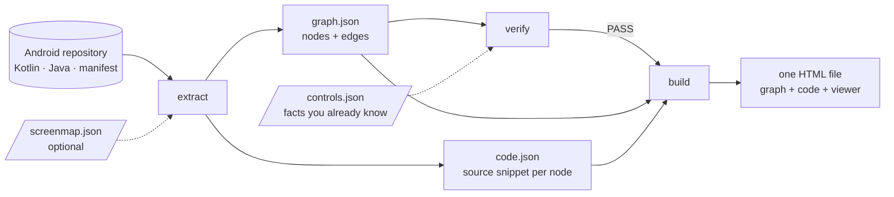
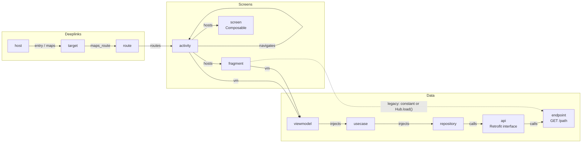
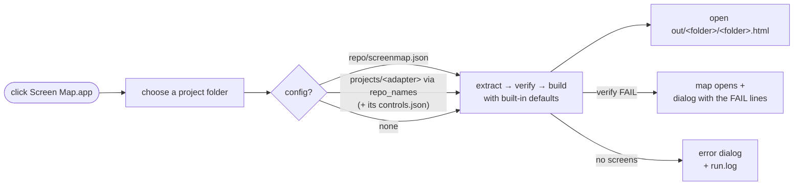

# android-screen-map

Point it at an Android (Kotlin) repository and get **one HTML file** that shows every screen, how deeplinks reach them,
and which REST endpoints each screen ends up calling — as a zoomable graph with the source code one click away.

No build, no compiler, no dependencies: plain Python 3.9+ reading the source with regexes and bracket matching.
A typical app (1,400 Kotlin files) takes about five seconds.

> 한국어 안내는 아래 [한국어](#한국어) 절에 있습니다.

## What it reads

| Layer | Source of truth | Node / edge |
|---|---|---|
| Screens | `AndroidManifest.xml` activities, `*Fragment` classes (Kotlin or Java), `@Composable fun *Screen(` | `activity` · `fragment` · `screen` |
| Deeplinks | manifest intent-filter hosts → (optional) your routing code: host constant → target → route → navigator → launcher → helper | `host` → `target` → `route` → activity (`entry`, `maps`, `maps_route`, `routes`) |
| Navigation | `Intent(ctx, X::class)`, `startActivity<X>()`, `X.createIntent(`, helper-object calls (overloads resolved by call-site arguments) | `navigates` |
| Data | ViewModel → UseCase → Repository interface → implementation → [DataSource → implementation] → Retrofit interface → `@GET/@POST`; or, for legacy apps, endpoint constants referenced from the screen directly or through one helper method (`Hub.load(`, `Hub.getInstance().load(` — `endpoints` config) | `vm` · `injects` · `calls` · per-node `endpoints` |
| Code | the declaration of every node, with comments, at its real line number | shown in the detail panel |

Every edge carries a confidence: **parsed** (read from code), **heuristic** (package proximity, dashed) or **dynamic**
(decided by a runtime parameter, dotted and hidden by default).

## How it works

Three steps, each a CLI command (`all` runs them in sequence). Nothing is written into your repository.



What the graph contains — one node per thing in the app, one edge per relation the reader could prove:



Solid arrows are read from code (`parsed`); the viewer draws package-proximity guesses dashed (`heuristic`) and runtime-decided
links dotted (`dynamic`). The legacy path (bottom) needs the `endpoints` config and skips the ViewModel/UseCase layer entirely.

The one-click launcher wraps the same three steps:



## Quick start

```bash
git clone <this repo> && cd android-screen-map
python3 -m screenmap all examples/sample-app -o out        # extract → verify → build
open out/screen_map.html                                   # or double-click it
```

On your own app:

```bash
python3 -m screenmap all ~/src/my-app -o out --name my_app
```

Without a `screenmap.json` the built-in defaults apply (modules `app`/`domain`/`data`, `*UseCase`, `*Repository`/`I*Repo`,
`*DataSource`, Hilt ViewModels, Retrofit). The deeplink routing stage is skipped until you describe your routing code.

`pip install -e .` gives you a `screenmap` command instead of `python3 -m screenmap`.

### One click (macOS)

```bash
cd macos && osacompile -o "Screen Map.app" screenmap-picker.applescript    # once; keep the .app in macos/ and drag it to the Dock
```

Clicking the app asks for a project folder (or drop a folder on the icon) and runs `macos/screenmap-run.sh`: extract →
verify → build → open `out/<folder name>/<folder name>.html`. A git repository is read through `git archive HEAD`, anything else in place.
Config comes from `<repo>/screenmap.json`, else the adapter under `projects/` whose folder is named like the repository folder or whose
config lists that name in `repo_names` (its `controls.json` is run too), else the defaults. The map opens even when
`verify` fails — a dialog then lists the `FAIL` lines (usually the config does not match that app); a folder with no screens gets an error
dialog instead. Log: `out/<folder name>/run.log`. The script works from a terminal too and exits 0 / 1 (built, verify failed) / 2 (nothing built).

## Configuration

Put a `screenmap.json` in the repository root or pass `--config`. Only the keys that differ from the defaults are needed;
keys starting with `_` are comments. Print the merged result with:

```bash
python3 -m screenmap config ~/src/my-app
```

| Key | Meaning |
|---|---|
| `title` | page title |
| `package` | root package. Omit to read the manifest `package` attribute or `namespace` in `app/build.gradle(.kts)` |
| `modules` | module directory names for `app`, `domain`, `data` |
| `source_roots` | where sources live inside a module (`src/main/java`, `src/main/kotlin`) |
| `ignore_scheme_prefixes` | intent-filters whose schemes start with these are SDK callbacks, not app deeplinks |
| `naming.*` | regexes / suffixes for UseCase, Repository, DataSource, ViewModel, Fragment, Screen, Activity |
| `deeplink.*` | your routing layer (see `examples/sample-app/screenmap.json`); `null` skips the stage |
| `perf.*` | instrumentation detection (trace constants + the call that starts a trace); `null` skips it |
| `repo_names` | repository folder names this config belongs to (`["notes-android", "notes-android-fork"]`), so the one-click launcher finds a config kept in `projects/<adapter>/` whatever the clone is called |
| `endpoints.*` | endpoints declared as constants instead of Retrofit annotations (legacy apps): `decl` is a regex with named groups `name` and `path`, optional `verb_near` gives the HTTP verb from the text before a reference. Any class that names a constant gets a direct `calls` edge, and a screen calling a helper's method gets that method's constants — no ViewModel/UseCase layer needed |

The deeplink section describes one routing shape that is common in MVVM apps:

```
manifest host ─▶ mapper.host_fn (when host → target constant)
             ─▶ mapper.target_fn (when target → Route.X)
             ─▶ navigator.navigate_fn (when Route.X → launcher.openX())
             ─▶ launcher override fun openX (Intent / helper object call) ─▶ Activity
```

`when_indent` is the indentation of the `when` arms in those functions (16 under ktlint defaults for a `when` inside a
member function body nested two levels). If your routing code has a different shape, leave `deeplink` out: you still get
manifest hosts, navigation and the full data chain.

## Commands

| Command | Does |
|---|---|
| `extract <repo> -o OUT` | writes `OUT/graph.json` and `OUT/code.json` (read-only on the repo) |
| `verify <repo> -o OUT [--controls c.json]` | sanity checks against the repo (endpoint count vs grep, activities vs manifest, …) plus your own controls |
| `build OUT [--perf p.json] [--name N] [--artifact] [--scrape-ui]` | renders `OUT/N.html` from the JSON files |
| `all <repo> -o OUT …` | the three in sequence; does not build when verify fails |
| `config [repo] [--config f]` | prints the merged configuration |
| `adapter <folder name> [--projects DIR]` | prints the path of the adapter config whose folder or `repo_names` matches; exit 1 when none (used by the launcher) |

Extracting from an exported copy (`git archive HEAD | tar -x -C dir`) keeps uncommitted changes out of the map; pass
`--branch`, `--commit` and `--repo-name` so the page header still says where the code came from.

### Controls

`verify --controls controls.json` takes a JSON list of facts about *your* app that must hold — the chains you already know.
When one fails the extractor is wrong for your code base, not your documentation.

```json
[
  {"exists": "host:open"},
  {"path": ["host:open", "activity:NoteDetailActivity"], "kinds": ["entry", "maps", "maps_route", "routes"], "via": ["target:NOTE"]},
  {"only": ["route:NoteDetail", "routes", ["activity:NoteDetailActivity"]]},
  {"reaches": ["GetNotesUseCase", "endpoint:NoteApi.list"]},
  {"edge": ["activity:MainActivity", "navigates", "activity:NoteDetailActivity"]}
]
```

### Performance overlay

`build --perf perf.json` attaches measured values to instrumented screens (double border, `p90` under the label, a
breakdown in the detail panel). The file is whatever you export from your APM; the viewer reads this shape:

```json
{"meta": {"fetched_at": "2026-10-26 10:40", "period": "last 7 days", "percentiles": [50, 90], "source": "…"},
 "traces": {"home_view_ready": {"p90": 646, "p50": null, "samples": 280000, "delta7d": -3,
                                "detail": {"ms": 646, "dist": {"pct": 90, "ms": 646, "min": 120, "max": 2100}},
                                "by": {"start_source": [{"value": "tap", "share": "95%", "ms": 628, "delta": -2}]}}}}
```

Trace names come from the `perf` config section (constants such as `TRACE_HOME = "home_view_ready"` next to the call that
starts the trace). `--scrape-ui` shows a "fetch" button that POSTs to `/scrape` on the server hosting the page — bring your own server.

## Output

- `graph.json` — `{meta, nodes[], edges[]}`; node `id` is `kind:identifier`; edges are `{s, t, kind, conf, via[], methods[]}`.
- `code.json` — `{node id: [{t: title, f: file, l: first line, s: source}]}`. **It contains your source code, and so does the HTML.**
  Treat the output like the repository itself.
- `<name>.html` — self-contained; at view time it loads Cytoscape and fcose from jsDelivr and two font families from Google Fonts
  (the only network access — the graph and the source never leave the file).

## Limits

- It is a heuristic reader, not a parser. Unusual formatting (a `when` at a different indent, generics in odd places) can
  hide edges silently — `verify` and your controls are the safety net. Run them every time.
- Only the routing shape described above is modelled. Navigation through a `NavHost` graph, WebView bridges and
  dynamically assembled URLs are not read (yet).
- Java is read for class declarations and supertypes (screens, endpoint-constant references) only: no constructor
  injection, no Retrofit interfaces in Java, no `when`-style routing. Screens reached by reflection (`Class.forName(id + "Fragment")`) have no incoming edge.
- Endpoint constants (`endpoints.decl`) are matched by their bare name anywhere in the app module (so `import static` works). A local
  variable or a second constant with the same name produces a false `calls` edge — keep constant names distinctive. A helper class that
  names constants is a *hub*: `Hub.member(` and `Hub.getInstance().member(` credit the caller with that member's constants, one hop only
  (no hub → hub recursion, no hubs held in instance fields, no top-level Kotlin `object` hubs, no `import static` of a hub method).
  Constants referenced outside any member (field initializers, static blocks) stay on the hub's `shared` node. Calls made by an abstract
  base screen are credited to the screens that extend it.
- A screen is attributed to a container by package proximity when no direct call is found; those edges are dashed.
- The viewer UI is in Korean. Node and edge semantics are documented above; an English UI is a welcome contribution.

## Development

```bash
python3 -m unittest discover -s tests -t .      # synthetic inputs only, no Android project needed
python3 -m screenmap all examples/sample-app -o out
```

`tests/test_parser.py` pins reader bugs found on real code (each test fails when its fix is reverted);
`tests/test_datachain.py` covers the naming conventions real projects mix; `tests/test_cli.py` runs the sample end to end.

Repository layout: `screenmap/` is the tool, `tests/` its unit tests, `examples/` a synthetic app, `macos/` the one-click
launcher. A `projects/<name>/` folder, if you add one, holds a per-app adapter (a config with `repo_names`, project-specific
verify controls, and the generated outputs — keep those out of version control, they embed that app's source).

## 한국어

안드로이드(Kotlin) 저장소를 가리키면 **화면 · 딥링크 · API 관계**를 거미줄 그래프 한 장(HTML)으로 만들어 줍니다.
확대·축소, 종류별 토글, 집중 보기, 노드 클릭 시 원문 코드 보기가 됩니다. 빌드도 컴파일러도 의존성도 없이 Python 3.9+만 있으면 됩니다.

```bash
python3 -m screenmap all examples/sample-app -o out    # 추출 → 검증 → 빌드
open out/screen_map.html
python3 -m screenmap all ~/src/my-app -o out --name my_app
```

- **원클릭(macOS)**: `cd macos && osacompile -o "Screen Map.app" screenmap-picker.applescript` 한 번 → `.app` 을 Dock 에 끌어 놓고 누르면
  프로젝트 폴더를 고르게 하고(아이콘에 폴더를 떨어뜨려도 됨) 추출·검증·빌드 뒤 `out/<폴더이름>/<폴더이름>.html` 을 연다. 설정은
  `<저장소>/screenmap.json`, 없으면 `projects/` 의 어댑터 중 폴더 이름이 같거나 `repo_names` 에 그 이름을 적은 것(대조군도 같이 돈다),
  없으면 기본값. verify 가 실패해도 지도는 열고 FAIL 줄을 대화상자로 보여 준다. 로그 `out/<폴더이름>/run.log`.
- 동작 순서와 그래프 모양은 위 [How it works](#how-it-works) 의 도식 세 개(추출 → 검증 → 빌드 · 노드와 엣지 종류 · 원클릭 흐름)를 보면 됩니다.
- 설정은 저장소 루트의 `screenmap.json` 또는 `--config`. 기본값과 다른 키만 적으면 되고 `_`로 시작하는 키는 주석입니다.
  `python3 -m screenmap config <저장소>`가 병합 결과를 보여 줍니다.
- 딥링크 라우팅 단계(`deeplink` 절)는 "호스트 상수 → 타깃 상수 → Route → Navigator → Launcher → Helper → Activity" 모양의
  코드를 읽습니다. 모양이 다르면 절을 빼면 됩니다(매니페스트 host·화면 이동·데이터 체인은 그대로 나옵니다).
- `verify`는 저장소와 독립적으로 대조(엔드포인트 수 = grep 수, Activity 수 = 매니페스트 수 등)하고, `--controls`로
  "이미 아는 체인"을 적어 두면 추출기가 틀렸을 때 바로 걸립니다. 재생성할 때마다 돌리세요.
- **산출물(HTML·code.json)에 소스 코드가 통째로 들어갑니다.** 저장소와 같은 수준으로 다루세요.
- 정규식 기반이라 한계가 있습니다(`when` 들여쓰기 의존, NavHost·WebView 브리지 미지원). 자세한 것은 위 Limits.
